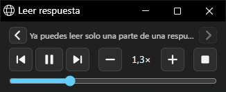

# read-reply

Lee en voz alta la última respuesta del agente de programación del panel activo de Herdr. Pulsas F9 y la oyes con Álvaro, la voz natural de Edge en español de España; vuelves a pulsar F9 y se calla. Mientras lee, una ventana pequeña sobre el terminal permite pausarla, saltar a otra frase, cambiar la velocidad y pararla. Nunca lee nada por su cuenta.

Funciona con Claude Code y Codex dentro de [Herdr](https://herdr.dev), en WSL sobre Windows.

## Requisitos

- Windows con WSL 2, y Herdr 0.9.5 o posterior dentro de WSL.
- Microsoft Edge en Windows, que viene con el sistema.
- En WSL: [uv](https://docs.astral.sh/uv/) y [pandoc](https://pandoc.org).
- Internet para la voz de Álvaro. Si Álvaro falla, la lectura sigue con una voz local de Windows, como Pablo; sin conexión no está probado.

## Instalación

```bash
uv tool install ~/dev/read-reply
```

El comando `read-reply` queda en `~/.local/bin`. Después, el atajo en `~/.config/herdr/config.toml`:

```toml
[[keys.command]]
key = "f9"
type = "shell"
command = "read-reply"
description = "Leer en voz alta la última respuesta del agente (otra vez: parar)"
```

y `herdr server reload-config` para cargarlo. Los errores salen como notificaciones de Herdr, que de serie están desactivadas: activa `[ui.toast] delivery = "herdr"` para verlas dentro de Herdr, o `"system"` para verlas como notificaciones de Windows. Para instalar una versión nueva del código: `uv tool install --reinstall ~/dev/read-reply`.

## Uso

- **F9** lee la última respuesta terminada del agente del panel activo. Si el agente está trabajando, lee la anterior.
- **F9 otra vez**, mientras lee, la corta.
- **La ventana**, arriba en el centro del terminal y por encima de las demás mientras lee, no se queda con el foco: sigues escribiendo donde estabas. Con un clic en ella:
  - **Pausa y continuar** (o espacio). Al continuar, vuelve al principio de la frase.
  - **⏮ y ⏭** (o ← y →) van a la frase anterior y a la siguiente.
  - **El deslizador** de abajo muestra por dónde va. Arrástralo, o haz clic en él, para saltar a la frase de ese punto.
  - **− y +** (o las teclas − y +) cambian la velocidad, de 0,5× a 2×. Se recuerda para la próxima vez.
  - **Parar** (o Esc, o cerrar la ventana).

  
- Los errores, como un panel sin agente, salen como notificación de Herdr, que llega a Windows si Herdr tiene `[ui.toast] delivery = "system"`.
- `read-reply --pane w1:p2 --print` escribe el texto tal como lo leería, sin leerlo. Sirve para revisar cómo queda una respuesta.

## Cómo funciona

1. Herdr pasa a sus atajos el panel activo en `HERDR_ACTIVE_PANE_ID`, y `herdr agent get` dice qué agente hay en él y cuál es su sesión (`herdr.py`).
2. La respuesta sale de la transcripción de esa sesión, que se lee desde el final porque alguna pasa de 600 MB (`transcripts.py`):
   - Claude Code: el último mensaje que cerró un turno, en `~/.claude/projects/` (o bajo `CLAUDE_CONFIG_DIR`).
   - Codex: el último mensaje de su última tarea terminada, en `~/.codex/sessions/` (o bajo `CODEX_HOME`).
3. pandoc convierte el Markdown en párrafos para el oído: sin marcas, con los bloques de código anunciados en vez de deletreados, las tablas fila a fila y los enlaces por su texto (`speech_text.py`).
4. Edge los lee con la Web Speech API estándar, que en Edge incluye las voces naturales de Microsoft, en una ventana de aplicación (`--app`) con los controles. Un servidor HTTP efímero en `127.0.0.1` le pasa a la página el texto y la orden de parar. La página se cierra al acabar, y Edge con ella (`player.py`, `player.html`).
5. La página lee fragmento a fragmento (`reading.mjs`). Para pausar, cambiar la velocidad o saltar, corta el fragmento y vuelve a pedirlo desde el principio de una frase o desde la palabra en curso, que Edge le dice con eventos `boundary`. Si Álvaro falla, lo intenta otra vez con él y, si vuelve a fallar, sigue con una voz local.
6. Mientras se prepara el texto, un script de PowerShell busca la ventana de Windows Terminal. Cuando se abre la de lectura, que reconoce por su perfil de Edge, la coloca arriba en el centro del terminal, por encima de las demás, y devuelve el foco a la ventana que lo tenía (`desktop.py`, `desktop.ps1`).
7. Una segunda pulsación encuentra ocupado el bloqueo de la lectura en curso y le pide que pare (`cli.py`).

Deja tres cosas fuera del repositorio: un perfil propio de Edge en `%LOCALAPPDATA%\read-reply\edge-profile`, de unos 45 MB y aparte del tuyo; la velocidad elegida, en `~/.local/state/read-reply/rate` (o bajo `XDG_STATE_HOME`), y el bloqueo, en `$XDG_RUNTIME_DIR/read-reply/`.

### Por qué así

- **La voz de Edge:** es la voz masculina en español de España más realista que se puede usar gratis y sin cuenta. Azure Speech da las mismas voces con API oficial, pero su plan gratuito (500.000 caracteres al mes) se queda corto. `edge-tts` usa el servicio interno de Edge, y Microsoft lo rompió a propósito en octubre de 2026.
- **La ventana, de Edge:** es la misma página que lee, así que no hace falta ninguna dependencia nueva. Un panel emergente de Herdr taparía el del agente y se quedaría con el teclado.
- **Pausar cortando:** `speechSynthesis.pause()` no hace nada con Álvaro: sigue hablando (medido en #7). Cortar y retomar sí funciona, a cambio de menos de un segundo de silencio antes de seguir.
- **pandoc:** un analizador de Markdown de verdad, en vez de expresiones regulares.
- **Solo la biblioteca estándar de Python:** no hay dependencias que instalar ni que vigilar.

## Límites

- Antigravity (`agy`) no está soportado: guarda sus conversaciones en bloques binarios de SQLite.
- Las rutas y el código dentro de una frase se leen tal cual.
- Al continuar tras una pausa o cambiar la velocidad, Álvaro tarda hasta un segundo en volver a hablar, y se nota el corte: es una voz online.
- Depende de que Edge siga ofreciendo sus voces online a las páginas web.
- La ventana se coloca sobre Windows Terminal. Con otro terminal, se abre sobre la ventana que tengas delante.

## Desarrollo

```bash
uv sync
git config core.hooksPath .githooks   # una vez por copia del repositorio
scripts/check                         # formato, lint, tipos y pruebas
```

Las pruebas de la página (`tests/js`) corren en Node.js 24 o posterior, sin dependencias.

La CI (GitHub Actions, `.github/workflows/ci.yml`) lanza `scripts/check` en cada PR y en cada push a `main`; en un repositorio público no gasta minutos. El hook `pre-push` lo lanza también antes de cada push, para enterarte antes de subir, y rechaza el push si falla o si hay cambios sin commit. Las pruebas necesitan pandoc.

`uv` solo instala versiones publicadas hace al menos dos semanas (`exclude-newer` en `pyproject.toml`): una versión maliciosa suele detectarse y retirarse en días. Dependabot propone una vez al mes las versiones nuevas de las dependencias y de las acciones de la CI, con la misma espera (`.github/dependabot.yml`).

### Probar que suena

Las pruebas no llegan a Edge, que solo corre en Windows. Para comprobar que una lectura se oye, mide el nivel de la salida de audio de Windows mientras lee:

```bash
powershell.exe -ExecutionPolicy Bypass -File "$(wslpath -w scripts/audio-meter.ps1)" -Seconds 20 &
uv run read-reply --pane <panel>
```

En silencio, el pico ronda 0,001. Mientras Álvaro habla, sube por encima de 0,1.

## Licencia

[MIT](LICENSE).
